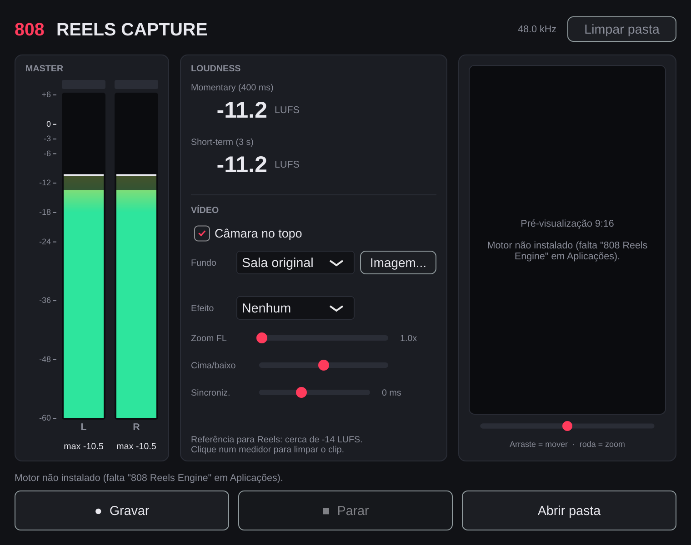

# 808 Reels Capture — o que fizemos e porquê

Documento de resumo do projeto até à versão **v0.2.11** (24/11/2026).
Serve para alinhar o **design e o nome** com quem vai trabalhar nessa parte.

---

## 1. O que é

Ferramenta pessoal para produtores no **FL Studio (macOS, Apple Silicon)** que grava
uma sessão e entrega **automaticamente um vídeo vertical pronto para Reels/TikTok**:

- **Câmara** numa faixa no topo do vídeo (com o fundo da sala opcionalmente trocado)
- **Janela do FL Studio** recortada na parte de baixo
- **Som do master** do FL, em qualidade de estúdio
- Efeitos retro opcionais (VHS, 8mm, Glitch ao ritmo, TV antiga)

Resultado: **MP4 1080×1920, 30 fps, H.264 + AAC 48 kHz**, guardado em
`Filmes › 808 Reels Capture`.

---

## 2. Como está construído (2 peças)

| Peça | O que faz | Tecnologia |
|---|---|---|
| **Plugin** "808 Reels Capture" (VST3 + AU) | Vai no **Master** do FL. Medidores, botões, controlos, pré-visualização. Grava o áudio do master em WAV 48 kHz. | C++ / JUCE 8 |
| **Motor** "808 Reels Engine" (app sem ícone no Dock) | Aberto sozinho pelo plugin. Capta a janela do FL e a câmara, monta o vídeo vertical, aplica fundo/efeitos, exporta o MP4. | Swift (ScreenCaptureKit, AVFoundation, Vision, Core Image) |

Os dois falam por um **socket local** (só dentro do Mac, porta 48808).

**Sem Mac de desenvolvimento nem Xcode:** tudo é compilado no **GitHub Actions** (Mac
da GitHub). Cada envio de código gera automaticamente uma versão nova na página
**Releases** do repositório, com um `.zip` e um script de instalação.

---

## 3. O que o utilizador vê (interface atual do plugin)

Janela de **760 × 600 px**, tema escuro. Três colunas + linha de estado + 3 botões.



*(Captura da janela atual. A pré-visualização aparece vazia porque foi tirada sem o motor ligado; no uso real mostra a câmara + o FL ao vivo.)*

### Cores atuais (para o designer)

| Uso | Cor |
|---|---|
| Fundo da janela | `#111216` |
| Painéis | `#1B1D23` |
| Bordas dos painéis | `#2A2D36` |
| Texto principal | `#E8E8EE` |
| Texto secundário | `#8A8D99` |
| Destaque ("808", Gravar, barras) | `#FF3B5C` (vermelho) |
| Medidor verde / amarelo / vermelho | `#2EE59D` / `#FFD23F` / `#FF3B5C` |

Letra: a do sistema (San Francisco no Mac). Ícone/logo: ainda não existe.

### Notas técnicas para o design
- A interface é **desenhada em código** (JUCE), não é HTML. Qualquer layout é possível,
  mas o ideal é entregar um **mockup com medidas, cores (hex) e fontes**. Imagens
  (logo, ícones, texturas) podem ser incluídas como PNG/SVG.
- O tamanho da janela pode mudar (hoje 760 × 600); pode também ser redimensionável.
- O **nome** aparece: no plugin (cabeçalho), no FL (lista de plugins), no motor
  ("808 Reels Engine"), na pasta de vídeos, nos nomes dos ficheiros e na página Releases.
  Mudar o nome mais tarde é possível, mas **os projetos do FL antigos deixam de
  reconhecer o plugin** se mudarmos os códigos internos — convém decidir o nome antes
  de usar a ferramenta a sério.
- O vídeo final (layout câmara/FL, textos do efeito VHS) também pode receber design:
  cores, moldura, logótipo/marca de água, etc.

---

## 4. Funcionalidades (o que já existe)

### Áudio e medidores
- Passa o áudio do master **sem alterações**.
- Medidores L/R com pico, RMS, *peak hold*, luz de clip e valor máximo (clicar limpa).
- **Loudness LUFS** (momentary 400 ms e short-term 3 s) — referência Reels ≈ -14 LUFS.

### Gravação
- **Gravar / Parar**. Cada take tem nome próprio com data e hora
  (`808 Reels 2026-11-24 22-10-05.mp4`) — **nenhum take apaga o anterior**.
- Ao carregar em **Parar**, o MP4 é **exportado automaticamente**.
- **Abrir pasta**: abre o Finder com o último vídeo selecionado.
- **Limpar pasta**: apaga **definitivamente** (sem Lixo) todos os vídeos e áudios,
  com uma confirmação que mostra quantos ficheiros/MB. Bloqueado durante gravação.
- Brutos de cada take (WAV + vídeo sem som) ficam em `808 Reels Capture/Brutos`.

### Vídeo
- **Layout**: câmara numa faixa de 600 px no topo (≈ 1/3), FL nos 1320 px de baixo,
  sem margens (inspirado em reels de produtores). Sem câmara → FL em ecrã inteiro.
- **Pré-visualização 9:16 ao vivo** dentro do plugin (15 fps), igual ao vídeo final.
- **Enquadramento do FL**: posição esquerda/direita, cima/baixo e **zoom 1×–4×**
  (barras, arrastar na pré-visualização, roda do rato / pinça no trackpad).
- **Fundo da câmara** (troca a sala atrás da pessoa): sala original, sala desfocada,
  imagem à escolha, preto, branco, cinzento, verde suave.
- **Efeitos retro**: Nenhum, VHS (com REC/contador/data 1998), Filme 8mm,
  Glitch ao ritmo (reage aos ataques do kick/808), TV antiga P&B.
- Câmara espelhada (como um espelho).

### Sincronização (automática)
- Áudio, câmara e ecrã usam **o mesmo relógio do Mac**; cada imagem guarda a hora em
  que foi realmente captada e o vídeo é montado com 0,8 s de folga para juntar
  imagens e som do mesmo instante.
- Compensa automaticamente o atraso do dispositivo de som (ex.: Bluetooth).
- Câmara **forçada a 30 fps** e **brilho automático** com pouca luz.
- Barra "Sincroniz." é só um ajuste fino opcional.

Tudo o que se escolhe (câmara, fundo, efeito, zoom…) fica **guardado em cada projeto do FL**.

---

## 5. Decisões tomadas e porquê

| Decisão | Porquê |
|---|---|
| Compilar tudo no GitHub Actions, assinatura ad-hoc (gratuita) | Não há Mac de desenvolvimento nem conta paga da Apple. Consequência: a cada versão nova o macOS volta a pedir autorização de ecrã e câmara. |
| Plugin + motor separados | Um plugin de áudio não deve captar ecrã/câmara nem codificar vídeo (pesado e arriscado para o FL). O motor faz isso fora do FL. |
| WAV do master gravado no plugin, em 48 kHz | Qualidade máxima do som, sem passar pelo microfone; 48 kHz é o padrão do vídeo. |
| Câmara no topo em faixa (em vez de círculo) | Pedido do utilizador com base em reels de referência. |
| Fundo = troca da sala atrás da pessoa (recorte com IA da Apple) | Escolha do utilizador entre as opções. Funciona no próprio Mac, sem internet. |
| **Não** fazer troca de cara por pessoas reais/personagens (ex.: Michael Jackson, Voldemort) | Seria um *deepfake* de pessoas reais e personagens protegidas; o utilizador não quis a alternativa (personagens originais). |
| Efeitos: VHS, 8mm, Glitch ao ritmo, TV antiga | Escolha do utilizador. |
| Sem título no vídeo, por agora | Decisão do utilizador. |
| "Exportar" virou "Abrir pasta" | A exportação já é automática ao Parar; o botão confundia. |
| Limpar pasta apaga de vez (com 1 confirmação) | Pedido do utilizador: não acumular ficheiros. A confirmação evita perder um vídeo por um clique acidental. |
| Sincronização automática em vez de manual | Feedback do utilizador: "deveria ser automático". |
| Câmara fixada a 30 fps + brilho automático | O vídeo de teste mostrou a câmara a só ~14 fps num quarto escuro (causa do "lag"). Confirmado: com mais luz, funciona. |

---

## 6. Problemas encontrados e resolvidos

1. **Compilação na fila do GitHub cancelada** → passou a usar `macos-latest`.
2. **Câmara atrasada em relação ao som** → alinhamento pela hora real de captura,
   montagem com folga, compensação da saída de som.
3. **Câmara aos soluços no escuro (~14 fps)** → 30 fps forçados + brilho automático.
   Dica: uma luz à frente da cara melhora muito a imagem.

---

## 7. Como instalar uma versão

1. Página: <https://github.com/fdefrederico-maker/808-reels-capture/releases>
2. Descarregar o `.zip` da versão mais recente e descompactar em Transferências.
3. Fechar o FL. No Terminal:
   ```bash
   bash ~/Downloads/808-Reels-Capture/instalar.sh
   ```
4. Abrir o plugin no Master; autorizar **Gravação de ecrã** e **Câmara**; fechar e
   reabrir a janela do plugin.

---

## 8. O que fica em aberto

- **Design e nome** (próximo passo — ver secção 3).
- Ideias possíveis para mais tarde (não pedidas): microfone para a voz, gravar
  automaticamente com o Play do FL, aviso de duração máxima do reel, escolher a câmara
  (ex.: iPhone), assinatura própria para não pedir permissões a cada atualização.

---

## 9. Histórico de versões

| Versão | O que trouxe |
|---|---|
| v0.1.1 | Plugin com medidores do master + compilação automática |
| v0.2.3 | Motor de vídeo, pré-visualização 9:16, gravação WAV + MP4 sincronizado |
| v0.2.4 | Câmara no topo + troca de fundo |
| v0.2.5 | Zoom e posição vertical do FL |
| v0.2.6 | Efeitos retro (VHS, 8mm, Glitch, TV antiga) |
| v0.2.7 | Botão Limpar pasta |
| v0.2.8 | Sincronização pela hora real de captura |
| v0.2.9 | Compensação automática da saída de som |
| v0.2.10 | Câmara a 30 fps com pouca luz + brilho automático |
| v0.2.11 | Botão Abrir pasta (exportação automática ao Parar) |
