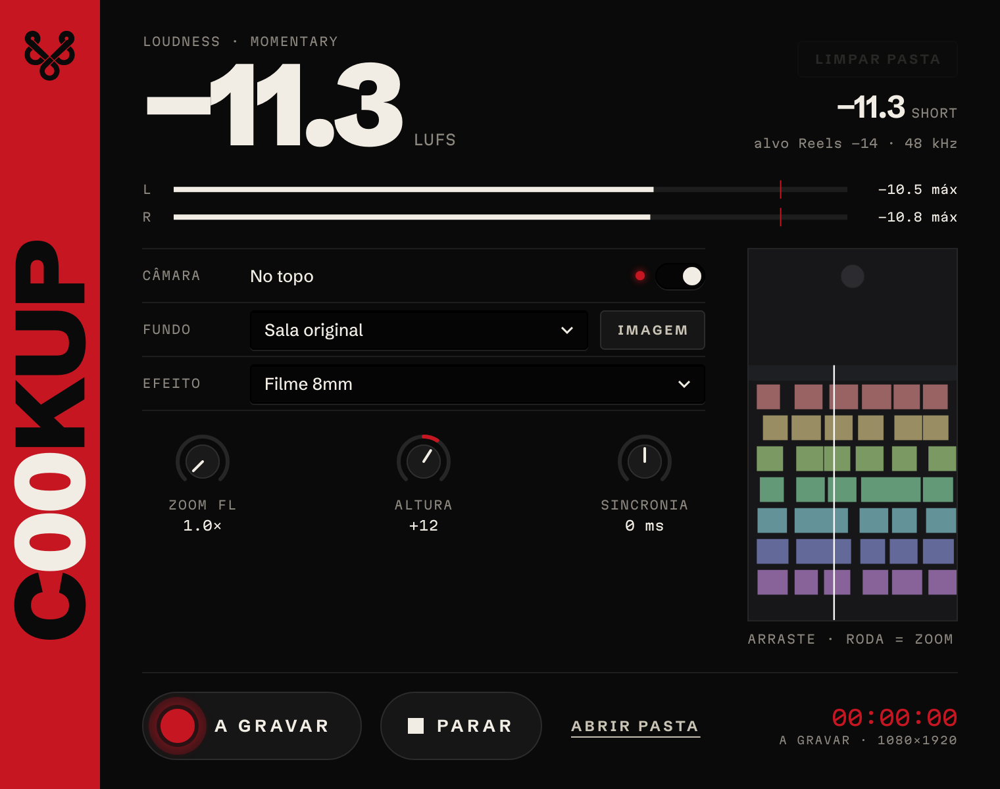

# C00KUP (808College) — o que fizemos e porquê

Documento de resumo do projeto até à versão **v1.0** (24/11/2026), em que o plugin
ganhou o nome e o visual finais: **C00KUP**, da **808College**.
Antes chamava-se "808 Reels Capture" (versões 0.x).

---

## 1. O que é

Ferramenta pessoal para produtores no **FL Studio (macOS, Apple Silicon)** que grava
uma sessão e entrega **automaticamente um vídeo vertical pronto para Reels/TikTok**:

- **Câmara** numa faixa no topo do vídeo (com o fundo da sala opcionalmente trocado)
- **Janela do FL Studio** recortada na parte de baixo
- **Som do master** do FL, em qualidade de estúdio
- Efeitos retro opcionais (VHS, 8mm, Glitch ao ritmo, TV antiga)

Resultado: **MP4 1080×1920, 30 fps, H.264 + AAC 48 kHz**, guardado em
`Filmes › C00KUP` (ficheiros `C00KUP 2026-11-24 22-10-05.mp4`).

---

## 2. Como está construído (2 peças)

| Peça | O que faz | Tecnologia |
|---|---|---|
| **Plugin** "C00KUP" (VST3 + AU, fabricante 808College) | Vai no **Master** do FL. Medidores, botões, controlos, pré-visualização. Grava o áudio do master em WAV 48 kHz. | C++ / JUCE 8 |
| **Motor** "C00KUP Engine" (app sem ícone no Dock) | Aberto sozinho pelo plugin. Capta a janela do FL e a câmara, monta o vídeo vertical, aplica fundo/efeitos, exporta o MP4. | Swift (ScreenCaptureKit, AVFoundation, Vision, Core Image) |

Os dois falam por um **socket local** (só dentro do Mac, porta 48809).

**Sem Mac de desenvolvimento nem Xcode:** tudo é compilado no **GitHub Actions** (Mac
da GitHub). Cada envio de código gera automaticamente uma versão nova na página
**Releases** do repositório, com um `.zip` e um script de instalação.

---

## 3. Nome, identidade e interface (v1.0)

### Identificadores

| Campo | Valor |
|---|---|
| Produto | `C00KUP` (com zeros) |
| Fabricante | `808College` |
| Códigos AU/VST3 | fabricante `Cl8g`, plugin `C00k` |
| Bundle do plugin | `com.808college.c00kup` |
| Motor | `C00KUP Engine` · `com.808college.c00kup.engine` · ícone com o símbolo 808College preto sobre `#C61621` |
| Pasta dos vídeos | `Filmes › C00KUP` (brutos em `C00KUP/Brutos`) |
| Ligação plugin ↔ motor | porta 48809, número mágico "C00K" |

### Interface

Desenhada segundo [`design-c00kup/SPEC.md`](../design-c00kup/SPEC.md) (direção D). Janela de **760 × 600 px**, que se pode esticar até ao dobro (1520 × 1200, mesma proporção; o tamanho fica guardado no projeto do FL): lombada vermelha com o símbolo e o wordmark C00KUP rodado, loudness em
grande, medidores L/R horizontais, controlos de vídeo, três knobs, pré-visualização 9:16 e
rodapé com Gravar / Parar / Abrir pasta, timecode e estado.




*(Capturas geradas a partir do próprio código do plugin. A pré-visualização aqui é uma imagem de
teste; no uso real mostra a câmara e o FL ao vivo.)*

- **Fontes embutidas** (BinaryData, licença OFL): Schibsted Grotesk (Medium, Bold, Black) e
  Martian Mono. Nada depende das fontes do sistema.
- **SVG embutidos**: símbolo 808College e wordmark C00KUP (o "00" em marfim).
- **LookAndFeel próprio**: knobs com arco de 270°, interruptor, campos rebaixados, pílulas,
  botões quadrados, link sublinhado, menus e dicas no mesmo estilo.
- **Knobs**: Zoom FL (1×–4×), Altura (−50…+50, bipolar) e Sincronia (−500…+500 ms, bipolar).
  Arrastar na vertical, duplo clique repõe, roda do rato.
- **Posição esquerda/direita** do FL: só a arrastar na pré-visualização (a barra saiu).
- **Estados**: a gravar (disco a pulsar a 1 Hz com anel e brilho, "A GRAVAR", Parar ativo,
  timecode vermelho, Limpar pasta desativado), desativado (40%), hover (bordas `#3A3A3A`,
  links a marfim), foco por teclado (contorno marfim de 2 px afastado 2 px).
- **Mensagens de estado** curtas, em maiúsculas, por baixo do timecode ("MOTOR PRONTO",
  "A EXPORTAR 45%", "MP4 PRONTO"…); erros a vermelho. A mensagem completa aparece como dica
  ao passar o rato.

### Cores

| Token | Cor | Uso |
|---|---|---|
| fundo | `#0A0A0A` | fundo da janela |
| vermelho | `#C61621` | lombada, Gravar, LED, arcos dos knobs, 0 dB, timecode a gravar |
| marfim | `#F1ECE4` | texto principal, medidores, ponteiros |
| cinza texto | `#8C877F` | rótulos e legendas |
| cinza botão | `#C9C3B6` | texto dos botões secundários |
| superfície | `#161616` | botões |
| campo | `#050505` | campos rebaixados e interruptor |
| linha | `#1F1F1F` | divisórias |

## 4. Funcionalidades (o que já existe)

### Áudio e medidores
- Passa o áudio do master **sem alterações**.
- Medidores L/R com pico, RMS, *peak hold*, luz de clip e valor máximo (clicar limpa).
- **Loudness LUFS** (momentary 400 ms e short-term 3 s) — referência Reels ≈ -14 LUFS.

### Gravação
- **Gravar / Parar**. Cada take tem nome próprio com data e hora
  (`C00KUP 2026-11-24 22-10-05.mp4`) — **nenhum take apaga o anterior**.
- Ao carregar em **Parar**, o MP4 é **exportado automaticamente**.
- **Abrir pasta**: abre o Finder com o último vídeo selecionado.
- **Limpar pasta**: apaga **definitivamente** (sem Lixo) todos os vídeos e áudios,
  com uma confirmação que mostra quantos ficheiros/MB. Bloqueado durante gravação.
- Brutos de cada take (WAV + vídeo sem som) ficam em `C00KUP/Brutos`.

### Vídeo
- **Layout**: câmara numa faixa de 600 px no topo (≈ 1/3), FL nos 1320 px de baixo,
  sem margens (inspirado em reels de produtores). Sem câmara → FL em ecrã inteiro.
- **Pré-visualização 9:16 ao vivo** dentro do plugin (15 fps), igual ao vídeo final.
- **Enquadramento do FL**: posição esquerda/direita (arrastar na pré-visualização), altura e
  **zoom 1×–4×** (knobs, roda do rato / pinça no trackpad).
- **Fundo da câmara** (troca a sala atrás da pessoa): sala original, sala desfocada,
  imagem à escolha, preto, branco, cinzento, verde suave.
- **Efeitos retro**: Nenhum, VHS (com REC/contador/data 1998), Filme 8mm,
  Glitch ao ritmo (reage aos ataques do kick/808), TV antiga P&B.
- Câmara espelhada (como um espelho).

### Sincronização (automática)
- Áudio, câmara e ecrã usam **o mesmo relógio do Mac**; cada imagem guarda a hora em
  que foi realmente captada e o vídeo é montado com 0,8 s de folga para juntar
  imagens e som do mesmo instante.
- Compensa automaticamente o atraso do dispositivo de som (ex.: Bluetooth).
- Câmara **forçada a 30 fps** e **brilho automático** com pouca luz.
- O knob "Sincronia" é só um ajuste fino opcional.

Tudo o que se escolhe (câmara, fundo, efeito, zoom…) fica **guardado em cada projeto do FL**.

---

## 5. Decisões tomadas e porquê

| Decisão | Porquê |
|---|---|
| Compilar tudo no GitHub Actions, assinatura ad-hoc (gratuita) | Não há Mac de desenvolvimento nem conta paga da Apple. Consequência: a cada versão nova o macOS volta a pedir autorização de ecrã e câmara. |
| Plugin + motor separados | Um plugin de áudio não deve captar ecrã/câmara nem codificar vídeo (pesado e arriscado para o FL). O motor faz isso fora do FL. |
| WAV do master gravado no plugin, em 48 kHz | Qualidade máxima do som, sem passar pelo microfone; 48 kHz é o padrão do vídeo. |
| Câmara no topo em faixa (em vez de círculo) | Pedido do utilizador com base em reels de referência. |
| Fundo = troca da sala atrás da pessoa (recorte com IA da Apple) | Escolha do utilizador entre as opções. Funciona no próprio Mac, sem internet. |
| **Não** fazer troca de cara por pessoas reais/personagens (ex.: Michael Jackson, Voldemort) | Seria um *deepfake* de pessoas reais e personagens protegidas; o utilizador não quis a alternativa (personagens originais). |
| Efeitos: VHS, 8mm, Glitch ao ritmo, TV antiga | Escolha do utilizador. |
| Sem título no vídeo, por agora | Decisão do utilizador. |
| "Exportar" virou "Abrir pasta" | A exportação já é automática ao Parar; o botão confundia. |
| Limpar pasta apaga de vez (com 1 confirmação) | Pedido do utilizador: não acumular ficheiros. A confirmação evita perder um vídeo por um clique acidental. |
| Sincronização automática em vez de manual | Feedback do utilizador: "deveria ser automático". |
| Câmara fixada a 30 fps + brilho automático | O vídeo de teste mostrou a câmara a só ~14 fps num quarto escuro (causa do "lag"). Confirmado: com mais luz, funciona. |
| Nome final **C00KUP** (808College), códigos `Cl8g`/`C00k` | Pacote de design aprovado. Mudou-se antes de usar o plugin em projetos a sério (códigos novos = plugin novo para o FL). |
| Porta da ligação plugin ↔ motor passou de 48808 para 48809 | Se o motor antigo "808 Reels Engine" ainda estiver instalado ou aberto, o C00KUP não fala com ele por engano. |
| Arcos dos knobs Altura e Sincronia partem do topo (zero) | É o que diz a SPEC e o pedido ("bipolares"). O HTML de referência desenhava-os a partir do mínimo; seguiu-se a SPEC. Sincronia passou a −500…+500 ms para o zero ficar no topo. |
| Medidores com 0 dB aos 90% da barra | SPEC: escala de −54 a +6 dB. |
| Instalador **.pkg** sem custos (não assinado pela Apple) | Distribuição gratuita: sem conta Apple Developer (99 USD/ano). Na 1.ª vez o utilizador carrega em "Abrir mesmo assim" em Privacidade e Segurança. Instala em /Library e /Applications e remove versões antigas/duplicadas. |
| Assinatura própria (certificado "C00KUP 808College", grátis) | Mantém a mesma identidade do motor entre versões, para o macOS não voltar a pedir as permissões de ecrã e câmara a cada atualização. A chave fica só nos Secrets do GitHub. |
| Windows fica para depois | O plugin compila, mas o motor de vídeo tem de ser reescrito para Windows; precisa de quem teste num PC. |
| Instalador remove sozinho a versão antiga | O FL vê o C00KUP como um plugin novo; assim não ficam dois plugins nem dois motores. Os vídeos antigos não são tocados. |

---

## 6. Problemas encontrados e resolvidos

1. **Compilação na fila do GitHub cancelada** → passou a usar `macos-latest`.
2. **Câmara atrasada em relação ao som** → alinhamento pela hora real de captura,
   montagem com folga, compensação da saída de som.
3. **Câmara aos soluços no escuro (~14 fps)** → 30 fps forçados + brilho automático.
   Dica: uma luz à frente da cara melhora muito a imagem.

---

## 7. Como instalar uma versão

1. Página: <https://github.com/fdefrederico-maker/808-reels-capture/releases>
2. Descarregar o `C00KUP-v….zip` mais recente e descompactar em Transferências.
3. Fechar o FL. No Terminal:
   ```bash
   bash ~/Downloads/C00KUP/instalar.sh
   ```
   (remove também a versão antiga "808 Reels Capture", se existir)
4. Abrir o plugin no Master; autorizar **Gravação de ecrã** e **Câmara**; fechar e
   reabrir a janela do plugin.

---

## 8. O que fica em aberto

- Ideias possíveis para mais tarde (não pedidas): microfone para a voz, gravar
  automaticamente com o Play do FL, aviso de duração máxima do reel, escolher a câmara
  (ex.: iPhone), assinatura própria para não pedir permissões a cada atualização.

---

## 9. Histórico de versões

| Versão | O que trouxe |
|---|---|
| v0.1.1 | Plugin com medidores do master + compilação automática |
| v0.2.3 | Motor de vídeo, pré-visualização 9:16, gravação WAV + MP4 sincronizado |
| v0.2.4 | Câmara no topo + troca de fundo |
| v0.2.5 | Zoom e posição vertical do FL |
| v0.2.6 | Efeitos retro (VHS, 8mm, Glitch, TV antiga) |
| v0.2.7 | Botão Limpar pasta |
| v0.2.8 | Sincronização pela hora real de captura |
| v0.2.9 | Compensação automática da saída de som |
| v0.2.10 | Câmara a 30 fps com pouca luz + brilho automático |
| v0.2.11 | Botão Abrir pasta (exportação automática ao Parar) |
| **v1.0** | Nome final **C00KUP** (808College), visual novo (SPEC direção D), fontes e SVG embutidos, knobs, estados, ícone do motor |
